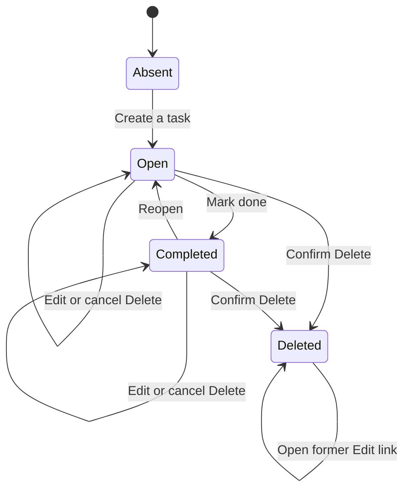

# Week 1 supplementary black-box test design

These decision tables and the state model were prepared retrospectively from the application, the requirement baseline and existing case evidence. The tables specify test conditions and expected behaviour. The manual suite records observations separately. [Application analysis](APPLICATION_ANALYSIS_AND_SCOPE.md) · [Week 7 RTM](../Week%207/Requirements%20Traceability%20Matrix.csv) · [Manual cases](SUPPLEMENTARY_MANUAL_TESTING.md)

## Registration decision table

Registration has two independent input validity conditions that produce different user-facing outcomes. Check on the web form with a fresh session, an unused username for positive cases and non-empty inputs so the form reaches server validation. Validity follows the advertised rule. A valid username is 3–20 characters using letters, numbers or underscores, and a valid password has at least eight characters.

| Rule | Username valid | Password valid | Expected action | Existing coverage and supplement |
| --- | --- | --- | --- | --- |
| R1 | Yes | Yes | Create an account, establish a session and open My Tasks. | Week 1 TC29 and Week 3 G01 cover successful registration. Week 1 TC10/TC28, Week 3 G14 and Week 4 W07 cover the eight-character boundary discrepancy. M04 and M05 compare eight and nine characters through the web form. |
| R2 | No | Yes | Reject registration and show the username validation message. | Week 1 TC04/TC30 and Week 3 G13. M01 adds direct manual evidence at length two. |
| R3 | Yes | No | Reject registration and show the password validation message. | Week 1 TC09/TC31 and Week 3 G13. M02 uses a seven-character password. |
| R4 | No | No | Reject registration. The username message appears first in the reviewed form's validation order. | G13 submits each invalid condition with the other input valid. M03 adds the simultaneous-invalid combination. |

The boundary fixtures apply equivalence partitions and vary passwords at 7, 8 and 9 characters. A three-character valid username provides the adjacent control for the two-character invalid value. The upper username boundary already appears in the historical suite. The first-error ordering for R4 is an implementation-derived behaviour check. The advertised eight-character minimum remains the functional oracle for M04. Username uniqueness is an inferred policy in F04/F26 and is tracked separately. [Registration form](../templates/register.html) · [Registration route](../app.py#L139) · [Historical Week 1 cases](Blackbox%20Testing.md#2-test-cases) · [Week 3 GUI cases](../Week%203%20-%20GUI%20Compatibility%20Usability%20Accessibility%20Testing/GUI_TESTING.md)

## My Tasks filtering decision table

Category, status and title search can be applied independently. The expected result is the intersection of all active conditions within the signed-in user's task list. An active category is one of the displayed categories, an active status is Open or Done, and an active title search uses a non-empty literal substring. Each inactive condition admits all candidates already permitted by the other conditions.

| Rule | Category active | Status active | Title search active | Expected task membership | Existing coverage and supplement |
| --- | --- | --- | --- | --- | --- |
| T1 | No | No | No | All owned tasks. | Week 3 G04 and Week 4 W04 provide unfiltered list checkpoints. |
| T2 | Yes | No | No | Owned tasks in the chosen category. | Week 3 G08. |
| T3 | No | Yes | No | Owned tasks in the chosen status. | Week 3 G08. Week 1 TC38 checks the analogous API behaviour. |
| T4 | No | No | Yes | Owned tasks matching the title substring. | Week 3 G07 and Week 4 W05. |
| T5 | Yes | Yes | No | Owned tasks matching both category and status. | Week 3 G08. |
| T6 | Yes | No | Yes | Owned tasks matching both category and title. | Week 4 W05 after category selection. |
| T7 | No | Yes | Yes | Owned tasks matching both status and title across categories. | The reviewed web checks lack a direct checkpoint for this combination. M06 adds it with two independent distractors. Week 4 A28 provides related API evidence. |
| T8 | Yes | Yes | Yes | Owned tasks matching category, status and title. | Week 4 W05 exercises the combination. Its fixture leaves the same matching row before and after the final status selection, so it supplies limited evidence of the status condition in that combination. |

M06 uses one task that matches both active filters, one matching the title only and one matching the status only. These outcomes can reveal if either condition is ignored. The selected manual suite keeps the focus on T7. A stronger T8 run could use one distractor per condition if deeper filtering coverage is needed. [Task list route](../app.py#L191) · [Filter controls](../templates/index.html#L9) · [Week 3 GUI cases](../Week%203%20-%20GUI%20Compatibility%20Usability%20Accessibility%20Testing/GUI_TESTING.md) · [Week 4 web cases](../Week%204%20-%20Web%20and%20API%20Testing/WEB_TESTING.md)

## Owned task state transition model

This diagram follows one task identity within an authenticated owner's session. New tasks start Open. The completion toggle changes between Open and Completed. Delete confirmation removes the task. An edit changes task details while preserving its completion state.

| ID | Starting state | Action | Expected state and observable result | Evidence and manual mapping |
| --- | --- | --- | --- | --- |
| S1 | Absent | Create a task with valid details | Open. The created task appears in My Tasks and is eligible for the Open filter. | Week 1 TC34 at the API, Week 3 G04 and Week 4 W04. Manual M07. |
| S2 | Open | Toggle completion | Completed. The task shows a checkmark and Done badge. | Week 3 G06 and Week 4 W04/A20. Manual M07. |
| S3 | Completed | Toggle completion | Open. The task keeps its identity and appears in the Open view. | Week 3 G06 and Week 4 W04/A20. Manual M07. |
| S4 | Open or Completed | Save a permitted edit | Original completion state persists. Updated fields appear in the list or edit form. | Week 3 G05 and Week 4 W04 demonstrate editing. The reviewed edit handler preserves completion fields. The focused session leaves a completed-state edit for follow-up. |
| S5 | Open or Completed | Cancel the Delete confirmation | The original state remains and My Tasks still contains the row. | Week 3 G10 and Week 4 W04. Manual M08 uses an Open task. |
| S6 | Open or Completed | Accept the Delete confirmation | Deleted. The row stays absent after a fresh list load. | Week 3 G10 and Week 4 W04. Manual M08 uses an Open task. The deletion route accepts either completion state. |
| S7 | Deleted | Open the tester's former Edit URL | Deleted. My Tasks opens and the deleted row remains absent. | The web edit handler redirects when the record is missing. Week 4 A25 provides related API evidence. Manual M09 is the direct web check. |

## Supplementary execution

A group tester executed M01–M09 on 27 November 2026 MYT. Eight cases passed. M04 confirmed the existing eight-character password defect, DEF-001. The M06 capture shows the expected result for the displayed search value of lowercase alpha. The M07 reopened state is captured. The Done step is recorded from the tester’s observation and its screenshot is unavailable. [Completed manual test records](SUPPLEMENTARY_MANUAL_TESTING.md)

The reviewed browser controls support create, edit, toggle and confirmed deletion. For the selected task identity, the state model ends with deletion. Creating another task starts a new identity. M07–M09 cover the valid sequence, cancellation and the negative stale-edit case. [Task routes](../app.py#L227) · [Task controls](../templates/index.html#L40) · [Week 3 GUI cases](../Week%203%20-%20GUI%20Compatibility%20Usability%20Accessibility%20Testing/GUI_TESTING.md) · [Week 4 web cases](../Week%204%20-%20Web%20and%20API%20Testing/WEB_TESTING.md)
