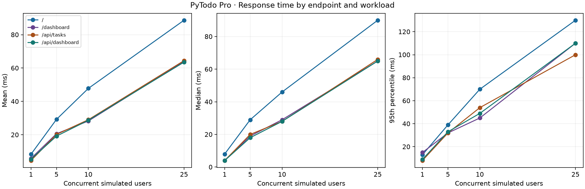
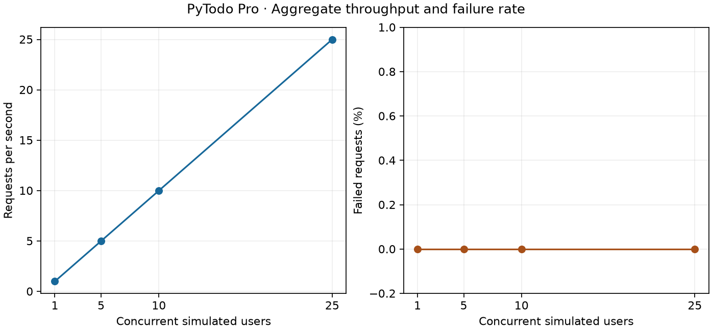

# PyTodo Pro · Week 5 performance testing

The [workload definition](test-data/WORKLOAD.md) specifies selection, traffic mix, authentication, stages and stop thresholds. The machine and seeded database were recorded before launching Flask. [Machine snapshot](results/environment.json) · [Locust execution](logs/locust.log) · [Flask log](logs/flask.log)

| Configuration | Measured or recorded value |
| --- | --- |
| Preflight UTC | 2026-11-27T11:38:04.877396+00:00 |
| Compute | GitHub Codespaces · Ubuntu 24.04.5 LTS · AMD EPYC 7763 x86_64 · 2 available logical CPUs |
| Memory and cgroups | Host-visible RAM 7942 MiB, 4023 MiB available at preflight. cpu.max = max 100000, memory.max = max. |
| Software | Python 3.14.2 · Flask 3.0.3 · Werkzeug 3.1.9 · SQLite 3.45.1 · Locust 2.47.0 · psutil 7.2.2 |
| Database | 167,936 bytes · 25 accounts · 1,500 tasks · 4 categories |
| Execution | One threaded Flask development-server process and one Locust process on the same host. Loopback HTTP. |

A preliminary run used the Flask 3.1.3 dependency pulled in by Locust. Its evidence is archived separately. The measurements below come from the Flask 3.0.3 rerun. [Preliminary environment](results/preliminary/environment.json) · [Preliminary execution](logs/preliminary/locust.log)

## Stage monitoring

| Users | Status | Authenticated | Timed seconds | Peak host CPU % | Peak Flask CPU % of one core | Peak Locust CPU % of one core | Peak combined RSS MiB | Stop reason |
| --- | --- | --- | --- | --- | --- | --- | --- | --- |
| 1 | Completed | 1 | 60.0 | 36.2 | 0.6 | 0.4 | 101.4 | — |
| 5 | Completed | 5 | 60.001 | 38.3 | 2.6 | 1.0 | 106.1 | — |
| 10 | Completed | 10 | 60.001 | 39.1 | 5.6 | 2.0 | 108.9 | — |
| 25 | Completed | 25 | 60.001 | 44.0 | 14.0 | 5.4 | 144.1 | — |

CPU and resident memory were sampled every five seconds. Host CPU includes background activity. The stage elapsed value is measured with a monotonic clock. [Resource samples](results/monitoring.csv) · [Stage metadata](results/stages.json)

## Aggregate and endpoint results

| Users | Endpoint | Requests | Failures | Error % | Req/s | Mean ms | Median ms | P95 ms |
| --- | --- | --- | --- | --- | --- | --- | --- | --- |
| 1 | Aggregated | 60 | 0 | 0.00 | 1.00 | 6.02 | 5.00 | 10.00 |
| 5 | Aggregated | 300 | 0 | 0.00 | 5.00 | 22.33 | 21.00 | 36.00 |
| 10 | Aggregated | 600 | 0 | 0.00 | 10.00 | 33.47 | 32.00 | 60.00 |
| 25 | Aggregated | 1500 | 0 | 0.00 | 25.00 | 70.17 | 72.00 | 120.00 |

| Users | Endpoint | Requests | Failures | Error % | Req/s | Mean ms | Median ms | P95 ms |
| --- | --- | --- | --- | --- | --- | --- | --- | --- |
| 1 | / | 15 | 0 | 0.00 | 0.25 | 8.32 | 8.00 | 13.00 |
| 1 | /dashboard | 15 | 0 | 0.00 | 0.25 | 5.83 | 4.03 | 15.00 |
| 1 | /api/tasks | 15 | 0 | 0.00 | 0.25 | 4.57 | 4.00 | 8.00 |
| 1 | /api/dashboard | 15 | 0 | 0.00 | 0.25 | 5.34 | 4.00 | 9.00 |
| 5 | / | 75 | 0 | 0.00 | 1.25 | 29.25 | 29.00 | 39.00 |
| 5 | /dashboard | 75 | 0 | 0.00 | 1.25 | 20.64 | 19.00 | 32.00 |
| 5 | /api/tasks | 75 | 0 | 0.00 | 1.25 | 20.21 | 20.00 | 32.00 |
| 5 | /api/dashboard | 75 | 0 | 0.00 | 1.25 | 19.21 | 18.00 | 33.00 |
| 10 | / | 150 | 0 | 0.00 | 2.50 | 47.83 | 46.00 | 70.00 |
| 10 | /dashboard | 150 | 0 | 0.00 | 2.50 | 28.28 | 29.00 | 45.00 |
| 10 | /api/tasks | 150 | 0 | 0.00 | 2.50 | 29.05 | 28.00 | 54.00 |
| 10 | /api/dashboard | 150 | 0 | 0.00 | 2.50 | 28.71 | 28.00 | 49.00 |
| 25 | / | 375 | 0 | 0.00 | 6.25 | 88.67 | 90.00 | 130.00 |
| 25 | /dashboard | 375 | 0 | 0.00 | 6.25 | 64.02 | 65.00 | 110.00 |
| 25 | /api/tasks | 375 | 0 | 0.00 | 6.25 | 64.45 | 66.00 | 100.00 |
| 25 | /api/dashboard | 375 | 0 | 0.00 | 6.25 | 63.56 | 65.00 | 110.00 |

All measured requests used GET. Throughput is the request count divided by measured seconds. Mean uses Locust response times, and median and P95 use Locust histogram buckets. Failures include incorrect status or body and transport errors. Credential setup and warmup are excluded. [Full CSV](results/performance.csv)

| Interpretation | Observation or implication |
| --- | --- |
| Observed range | 4 stages completed with 2,460 measured requests and 0 failures. At 25 users, throughput was 24.999 req/s and aggregate P95 was 120 ms. The highest endpoint P95 in the measured matrix was 130 ms. |
| Slowest sampled endpoint at 25 users | The web task list recorded 130 ms P95, compared with 100–110 ms for the other three endpoints. Profiling would help identify where the additional time is spent. |
| Pacing | The request rate was intentionally limited to about one per user per second. Throughput close to that limit indicates the paced workload was sustained. The experiment did not seek a saturation point. |
| Resource limits | Peak sampled combined RSS was 144.1 MiB and peak sampled host CPU was 44%. Shared cloud-host activity can influence those measurements. |
| SQLite | The fixture is small and the measured workload reads only. The experiment gives no estimate of lock contention or throughput under concurrent writes. |
| Server and network | The Flask development server and load generator share CPUs and memory. Loopback excludes WAN latency, TLS, reverse proxies, browser rendering and production worker settings. |
| Sample size | Each workload was measured for 60 seconds, once on the pinned stack. Tail values at one user are especially sensitive to individual observations. The stages ran in ascending order against the same server and database, so cache and background effects can carry across stages. |
| Follow-up | Repeat the run for longer on a production-like WSGI and database configuration with a separate generator. Add a representative bounded write mix, and compare results to explicit latency and error objectives. |
