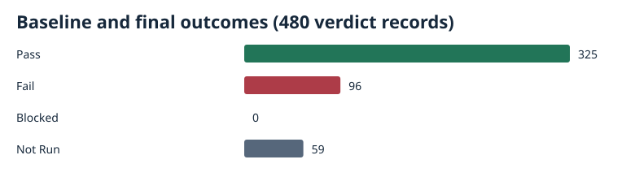
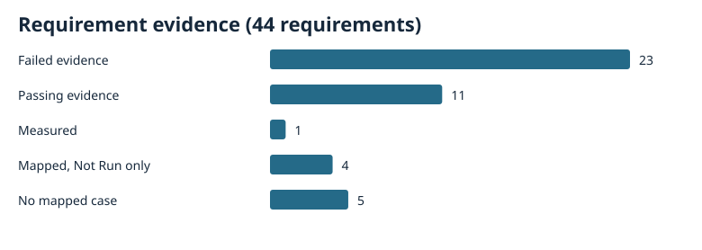
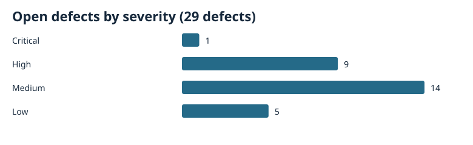
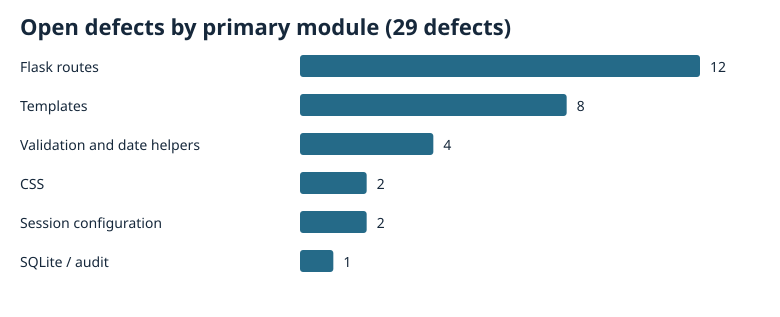
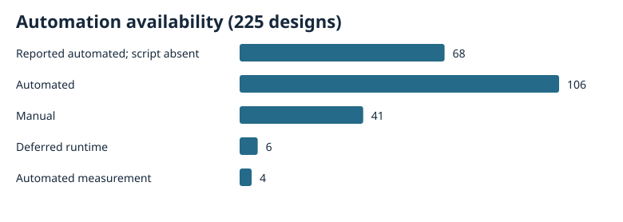
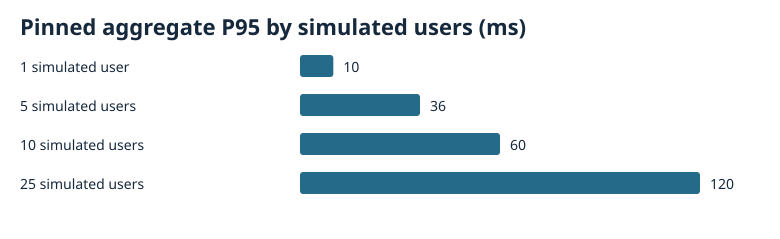

# PyTodo Pro · Software quality metrics

## Counting rules

The headline population is the Week 7 baseline plus final regression. A planned verdict record is one documented case/configuration/attempt with a Pass, Fail, Blocked or Not Run status. Executed means a Pass or Fail verdict was reached, including defensive source assertions. A Blocked record represents an infrastructure barrier that prevented a product verdict. The four timed workload designs and eight measured stages use a separate population. Planned records reflect the documented inventory and include deferred checklist designs. They do not estimate all testing the project could have planned. [Execution history](../Week%207/Execution%20History.csv) · [Execution metrics CSV](execution_metrics.csv)

| Evidence group | Planned | Executed | Passed | Failed | Blocked | Not Run |
| --- | ---: | ---: | ---: | ---: | ---: | ---: |
| Week 1 black-box | 42 | 42 | 32 | 10 | 0 | 0 |
| Week 2 white-box | 26 | 26 | 22 | 4 | 0 | 0 |
| Week 3 engine matrix | 141 | 141 | 115 | 26 | 0 | 0 |
| Week 3 device emulation | 104 | 104 | 90 | 14 | 0 | 0 |
| Week 3 manual and templates | 41 | 0 | 0 | 0 | 0 | 41 |
| Week 4 web, API and comparison | 45 | 43 | 29 | 14 | 0 | 2 |
| Week 5 security | 24 | 20 | 12 | 8 | 0 | 4 |
| Week 6 final regression | 57 | 45 | 25 | 20 | 0 | 12 |
| **Baseline plus final** | **480** | **421** | **325** | **96** | **0** | **59** |
| Week 6 initial attempt | 57 | 29 | 16 | 13 | 16 | 12 |
| All verdict records including initial | 537 | 450 | 341 | 109 | 16 | 71 |

The initial Week 6 JUnit has 17 failures. The runner identifies four of them as source-fixture infrastructure failures, leaving 13 product assertion failures. The twelve browser cases that could not start are also Blocked in Week 7. The Week 3 sandbox startup incident produced zero case records. These are separate from the 12 deliberately deferred Week 6 checks. [Initial regression results](../Week%206%20-%20Test%20Automation%20and%20Regression/logs/initial-attempt/regression-results.json) · [Week 3 sandbox log](../Week%203%20-%20GUI%20Compatibility%20Usability%20Accessibility%20Testing/logs/sandbox-execution.log)

## Rate definitions and denominators

Each row gives the inputs to numerator ÷ denominator × 100. Per-run execution, pass and failure rates are in the CSV. A suite with zero verdicts has undefined pass and failure rates. [Calculated rates CSV](calculated_rates.csv)

| Metric | Numerator ÷ denominator | Rate |
| --- | --- | ---: |
| Headline execution | Executed verdict records ÷ planned verdict records = 421 ÷ 480 | 87.71% |
| Headline pass | Passed ÷ executed = 325 ÷ 421 | 77.20% |
| Headline failure | Failed ÷ executed = 96 ÷ 421 | 22.80% |
| Unique verdict-case execution | Designs with a verdict ÷ verdict designs = 174 ÷ 221 | 78.73% |
| All-design evidence coverage | Designs with verdict or measurement ÷ all designs = 178 ÷ 225 | 79.11% |
| Requirement design coverage | Requirements with mapped designs ÷ all requirements = 39 ÷ 44 | 88.64% |
| Requirement verdict coverage | Requirements with a Pass/Fail ÷ all requirements = 34 ÷ 44 | 77.27% |
| Requirement execution coverage | Requirements with verdict or measurement ÷ all requirements = 35 ÷ 44 | 79.55% |
| Explicit requirement execution coverage | Explicit requirements with evidence ÷ explicit requirements = 12 ÷ 12 | 100.00% |
| Inferred requirement execution coverage | Inferred requirements with evidence ÷ inferred requirements = 23 ÷ 32 | 71.88% |
| Repository assertion automation | Repository assertion designs ÷ all designs = 106 ÷ 225 | 47.11% |
| Repository automation including load | Repository assertion and measurement designs ÷ all designs = 110 ÷ 225 | 48.89% |
| Historical automation including load | Repository and report-only automated designs ÷ all designs = 178 ÷ 225 | 79.11% |
| Helper statement coverage | Statements hit ÷ measured statements = 31 ÷ 31 | 100.00% |
| Helper branch coverage | Branches hit ÷ measured branches = 18 ÷ 18 | 100.00% |
| Week 6 final pass | Passed ÷ executed = 25 ÷ 45 | 55.56% |
| Week 6 final failure | Failed ÷ executed = 20 ÷ 45 | 44.44% |
| Reused verdict stability | Matching earlier verdicts ÷ reused cases = 39 ÷ 39 | 100.00% |
| Persistent failures in reused subset | Still failing ÷ reused cases = 17 ÷ 39 | 43.59% |
| Request failure, each Week 5 workload | Failed timed requests ÷ timed requests = 0 ÷ 2,460 | 0.00% |

Of 225 distinct designs, 116 have only passing verdicts, 56 only failing verdicts, two mixed verdicts across configurations, four measurements and 47 no execution. There are 247 repeated Pass/Fail executions beyond the first verdict per tested design (421 − 174). There are 12 repeated Not Run records beyond the 47 unexecuted designs. Configuration repeats and Week 6 reruns retain their master IDs. Designs that exercise the same requirement at different interfaces or with different oracles retain separate IDs. Deferred historical designs with overlap retain their source identity. [Coverage counts CSV](coverage_counts.csv) · [Master test cases](MASTER_TEST_CASES.csv)

The RTM has 23 requirements with failing evidence, 11 with only passing verdicts among those executed, one measurement-only, four mapped with only Not Run evidence and five without mapped designs. A requirement can have a passing or failing verdict and still have unverified scope. [Requirement coverage CSV](requirement_coverage.csv)

## Defects

| Dimension | Counts |
| --- | --- |
| Severity | Critical 1, High 9, Medium 14, Low 5 |
| Priority | P1 3, P2 7, P3 14, P4 5 |
| Primary module | Flask routes 12, templates 8, validation and date helpers 4, CSS 2, session configuration 2, SQLite/audit 1 |
| Affected features | Registration 2, dashboard 2 and API request validation 2. Twenty-three other feature labels each have one defect, including search, deletion, due dates, mobile layout and form accessibility. |

Each of the 29 open master IDs contributes once per dimension. Week 8 assigned one primary module and one affected feature per defect for the charts. Shared causes retain all affected locations in the register. For example, date persistence has one record covering API create and update, and responsive layout has one record spanning templates and CSS. Open status persists for 17 findings checked in Week 6 and 12 last verified earlier. [Aggregate breakdown](defect_metrics.csv) · [Per-defect classification](defect_breakdown.csv) · [Master defect register](MASTER_DEFECT_REGISTER.csv)

## Coverage, automation and performance interpretation

The reported statement and branch results apply to four helpers and module-level definitions in `helpers.py`. Four assertions still failed in that run. Reaching a branch establishes execution of a control-flow outcome and depends on what the tool counts. Correct boundary results, exception handling, interactions, route-level structure and data combinations require separate checks. The repository has no raw Week 2 coverage artifact or application-wide structural percentage. [Week 2 coverage report](../Week%202%20-%20White%20Box%20Testing/White-Box-Testing.md#5-execution-and-measured-coverage)

Of the automated designs, 68 are report-only historical cases. The remaining inventory includes 41 manual and six deferred runtime designs. Week 6 added six integration cases, three passing and three failing. All 39 reused cases matched earlier verdicts, including 17 failures. That is repeatability within the selected fixtures and stack. The 20.201-second measured run has no comparable manual timing. Physical-device, assistive-technology and participant evaluations still require manual work. [Week 6 regression](../Week%206%20-%20Test%20Automation%20and%20Regression/REGRESSION_TESTING.md) · [Automation reflection](../Week%206%20-%20Test%20Automation%20and%20Regression/AUTOMATION_REFLECTION.md)

The pinned workload's aggregate P95 was 10, 36, 60 and 120 ms at 1, 5, 10 and 25 simulated users. The preliminary run measured 16, 33, 64 and 140 ms. Both ran paced authenticated reads for four approximately 60-second stages. P95 is the reported 95th-percentile response time from each stage's recorded request durations. Throughput is timed requests ÷ stage seconds (for example, 1,500 ÷ 60.001 ≈ 24.999 req/s at the pinned 25-user stage). The pacing and fixture size limit capacity claims. [Stage values and denominators](performance_metrics.csv) · [Week 5 performance report](../Week%205%20-%20Security%20and%20Performance%20Testing/PERFORMANCE_TESTING.md)

